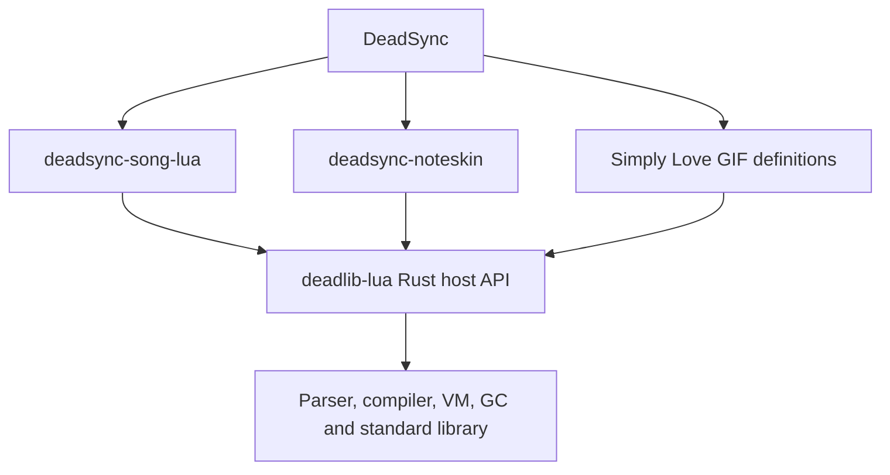

# Lua architecture

## Ownership



The shared engine owns language semantics and Lua object lifetimes. Domain
adapters own actor behavior, song clocks, player options, noteskin definitions,
media loading and conversion into native rendering data. Domain-specific actor
or gameplay behavior belongs in those adapters.

Lua values belong to their VM. Host callbacks borrow arguments and keep retained
objects in traced captures or explicit roots. Opaque Rust binding data is not
scanned by the collector. A synchronous Rust callback cannot yield its Rust
stack; coroutine scheduling remains inside the VM.

## Song execution

The Song Lua option selects **Baked** (the default) or **Runtime**. Baked
preparation executes eligible work before gameplay, samples native scene tracks
and releases the Lua VM. The loading screen receives preparation progress.
Runtime mode retains the VM and updates the shared actor scene during play.
Input callbacks that require runtime execution use the same Rust engine through
the runtime fallback path.

The compiler and live scene share the actor host, ownership rules, clocks and
rendering data. Changes to one execution strategy must preserve supported song
behavior in the other. Themes consume the resulting gameplay interfaces rather
than providing an alternate Lua implementation.

ProgramCache stores verified code and immutable compiler metadata. It does not
store VM globals, mutable objects or a baked gameplay scene. Each VM binds cached
programs to its own runtime state.

## Supported interface and tests

The engine exposes Rust callbacks, userdata, roots, protected calls, Lua errors,
coroutines, Lua/preload modules and native Lua 5.1 bytecode. It does not expose a
Lua C API/ABI or load third-party Lua C modules. Platform FFI and CPU intrinsics
are independent of that language interface.

Initialize the pinned [test fixtures](../README.md#test-fixtures), then run:

```sh
cargo test -p deadlib-lua
cargo test -p deadsync-song-lua --features test-support
cargo test --test full_song_lua -- --list
```

Reference fixtures and native controls validate compatibility. Tests should
exercise the current implementation and its contracts. Temporary performance
experiments, alternate implementations and measurement reports belong outside
the committed source tree.
