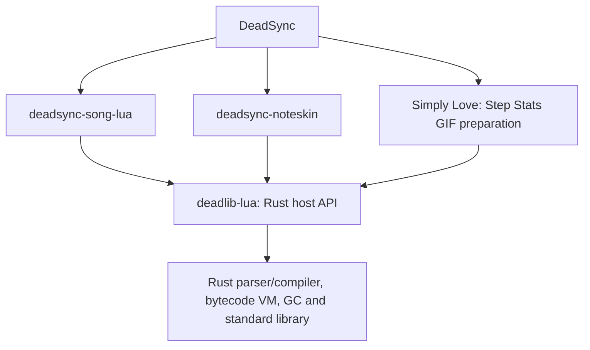
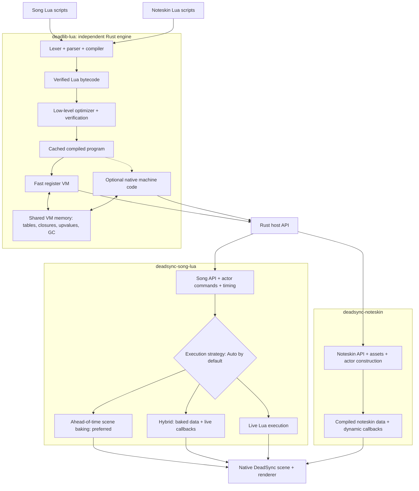

# Lua architecture and delivery contract

Accepted direction: 2026-11-03; scope corrected by the user on 2026-11-04.
This is the architecture contract for future Lua
work. [lua-engine.md](lua-engine.md) records implementation status and historical
evidence; [lua-cache.md](lua-cache.md) describes the existing program cache.
When older progress notes describe a different work order, this contract governs
future work. The diagram describes production ownership. The completed migration
and its validation limits are recorded in the [completion audit](testing/2026-11-04-rust-lua-production-migration/completion-audit.md).

## Objective and priorities

**Completed user-requested scope: migrate every existing production Lua consumer
to `deadlib-lua`.** The separately authorized production migration explicitly
supersedes the earlier "integration deferred" instruction. Its fixed scope and
evidence are recorded in the [migration ledger](testing/2026-11-04-rust-lua-production-migration/README.md)
and [verbatim objective](testing/2026-11-04-rust-lua-production-migration/objective.txt).
The public song facade uses the Rust engine unconditionally for preparation,
live scenes, reloads and fallback. Noteskin preparation and Simply Love's Step
Stats GIF loader use the same engine. Song native comparisons are isolated to unit tests or the explicit
legacy-oracle feature; neither selects the production engine.

The [fixed inventory review](testing/2026-11-04-rust-lua-production-migration/production-inventory-audit-v1/README.md)
accounts for every originally recorded production dependency, raw access and
handle candidate. Normal and instrumented application normal/build dependency
graphs each contain 399 unique package names and no legacy Lua runtime; the guarded current
results are in [production-lua-graph-v2](testing/2026-11-04-rust-lua-production-migration/production-lua-graph-v2/result.json).
The full song run plus launch-only retries passes 2,190 checks with the
recorded pre-existing mesh assertion. The normal release application build,
Rust-only link map and rendered gameplay smoke pass. Core, noteskin and GIF
regressions pass. Downstream replay-hook validation, remaining Clippy and
matched preparation/live/memory measurements are still in progress.
The [completion audit](testing/2026-11-04-rust-lua-production-migration/completion-audit.md)
tracks those original requirements. Dated adapter records preserve earlier
snapshots and do not add requirements to the migration.

Completion requires the full song, live callback, noteskin and GIF paths to use
the shared Rust engine, preserve existing supported behavior, pass application
validation and remove legacy from normal/build dependencies. Stop at those
criteria; new StepMania features, baking capabilities and language parity work
are separate requests.

The interpreter milestone is complete for its recorded source snapshot. The
separate removal goal is also complete: Lua C API/ABI compatibility was removed
while preserving the interpreter and Rust host API. Its verified finish line is normal Rust-only builds, no
Lua C interface in production artifacts, applicable regression checks with no
unexplained new failures, and matching active tooling/documentation. Unrelated
interpreter defects do not keep that removal goal open. Performance expansion
is deferred. Both milestones remain closed; the new migration has its own
explicit authorization and does not reopen either milestone.

Build an independent Lua engine in Rust with Lua 5.1 language semantics, shared
eventually by song and noteskin integrations through a Rust host API. DeadSync does not
require a drop-in implementation of Lua's C API. C ABI compatibility, loading
third-party Lua C modules, C-specific continuation behavior, `lua_Alloc` parity
and private C-runtime T/testC helpers are permanently excluded from the supported engine interface. They do not
gate the Rust engine or its DeadSync integrations. This correction supersedes
the earlier standalone C-compatibility completion requirement.

The production consumers depend on the shared engine:

The engine implements Lua; the adapters implement song, actor and noteskin
behavior. Use the pinned PUC interpreter as a test oracle for relevant Lua
semantics without depending on it for production execution. Rust API ownership,
error handling and resource behavior need their own explicit contract; exact
PUC C-stack layouts and allocation sequences are not that contract.

The preferred gameplay path is ahead-of-time
scene baking: perform eligible Lua work during preparation and play the resulting
native scene without repeating that Lua work every frame. Live execution and
hybrid execution are first-class capabilities for behavior that remains dynamic.

Measure representative preparation, live execution and memory against the
recorded production baseline. Earlier LuaJIT performance aspirations are not
acceptance criteria for this migration. Measure runtime execution separately
from the end-to-end gains of existing scene baking.

Correct Lua 5.1 behavior is mandatory across execution strategies and backends.
Later Lua 5.2-5.5 dialects remain an extension goal, but must not displace the 5.1,
scene-baking and live-execution work. Keep one shared compiler/runtime foundation.

## Target pipeline

The engine owns language semantics, bytecode, optimization, execution, objects,
GC and Rust host-call boundaries. The integrations own their domain APIs, dependency
capture, scene construction, baking policy and renderer-facing data. Song and
noteskin support must reuse the engine rather than grow separate Lua evaluators.

The diagram's earlier "Pure Rust" label means an independently owned engine,
without delegating execution to a linked C Lua/LuaJIT runtime. It is not a ban on
unsafe Rust, intrinsics, inline assembly, assembly backends or necessary platform
FFI. Platform FFI is distinct from the removed Lua C compatibility interface.
Keep the portable interpreter available on supported targets. Native code
is optional to run the engine; its absence must not disable scene baking.

## Independent stages and artifacts

| Stage | Contract | Output |
| --- | --- | --- |
| Compile | Parse source or import supported native chunks without executing the user's program. | Verified, VM-independent program. |
| Optimize | Transform that program while preserving the selected Lua semantics, including observable errors, hooks and numeric behavior. Verify transformed code. | Reusable optimized program and execution metadata. |
| Execute | Run through the register VM or a supported native backend, using the same object model and host-call contract. | Lua values and host effects. |
| Bake | Execute/analyze eligible host behavior against an explicit preparation environment and convert it to native scene operations. | Scene/noteskin artifact, dependency manifest and any residual live callbacks. |
| Play | Evaluate the native scene and run residual callbacks only where needed. | Native scene updates and renderer input. |

Ahead-of-time **scene baking** produces scene data: actor structures, assets,
timelines, curves, commands and supported parameterized operations. Ahead-of-time
**machine-code compilation** produces executable code. They are separate choices;
the baker can use the interpreter or native backend, and live execution can use
either backend. Caching bytecode alone does not constitute scene baking.

Expose independently testable compile, optimize and bake stages with explicit
inputs and identities. Prefer evaluating native curves and commands over storing
an unbounded per-frame trace. Account for bake time and artifact size as well as
playback cost; preparation can happen at load time or earlier when inputs exist.

## Execution strategies and equivalence

`Auto` is the intended default policy. It prefers full baking when equivalence
can be established, otherwise hybrid execution, otherwise live execution. Expose
explicit live, bake and hybrid selection for validation and diagnosis. A forced
bake that cannot cover the requested behavior must explain the unsupported
dependency; it must not silently discard behavior or call a hybrid result baked.
Selection names here describe the contract, not an existing public API.

Bake deterministic work whose dependencies are known or can be represented as
native runtime inputs. Time-dependent behavior can become a native timeline or
curve if it preserves the required clock semantics. Player actions, mutable
external state, messages and unknown callbacks must remain dynamic unless their
behavior is faithfully represented in the scene. One recorded playthrough or a
few sampled frames cannot establish equivalence for all future inputs.

Live, baked and hybrid paths must agree on actor identity and hierarchy, command
and message ordering, callback effects, timing and beat conversions, tweens,
randomness, errors and visible rendering behavior. Cover seeks, rate changes,
stops/warps, pause/resume and event boundaries. Preserve evaluation order and
numeric behavior under the pinned reference contract; record any allowed
rendering tolerance explicitly rather than silently approximating Lua results.
Validate the new live path against the existing legacy/ITGmania host-semantic
tests as well: agreement between two new strategies can conceal a shared bug.

Interpreter/native transitions within a running state share tables, closures,
upvalues, environments, userdata and GC ownership. Hybrid execution must preserve
that identity with the residual callbacks. Cached immutable programs may be
shared across independent VMs; mutable Lua objects must not be shared accidentally
between unrelated instances or reconstructed as disconnected copies at a handoff.

Baking and fallback must not duplicate initialization, RNG consumption, messages,
file/network writes or other externally visible effects. Capture/model effects
where possible; leave unsupported effects on the live path. Establish a valid
handoff or restart boundary before exposing effects. If dependencies change,
invalidate/rebuild or fall back with defined state continuity, not by silently
re-running an already published portion of the script.

## Cache identities

Keep three artifact classes distinct: compiled programs, optional native code,
and baked scenes/noteskins. The current [ProgramCache](lua-cache.md) implements
only the first class. A program cache hit does not prove a scene cache hit.

Scene identity must cover the program and transitive script/module dependencies,
asset identities, chart/song timing, relevant preferences and player configuration,
RNG policy/state, host API and baker versions, and every captured environmental
input. Record dependencies actually used; unknown or untracked inputs prevent
reuse unless they remain explicit runtime inputs. Native artifacts additionally
bind backend/ABI/CPU features and numeric/code-generation settings.

Persist stable scene data and bindings, not raw VM IDs, pointers or live closure
addresses. Residual callback reconstruction must preserve its declared state and
identity relationships. Reject stale/incompatible artifacts and rebuild from
authoritative inputs. Validate cache hits, misses and invalidation against the
same uncached semantics, including changed dependencies and fresh processes.

## Performance implementation policy

Study [LuaJIT's interpreter and tracing compiler](https://luajit.org/luajit.html)
and [source](https://github.com/LuaJIT/LuaJIT/tree/v2.1). Source reuse/adaptation,
unsafe Rust, SIMD/intrinsics, inline assembly and dedicated assembly paths are
explicitly permitted where justified. Record upstream revision and provenance
and retain applicable copyright/license notices for reused code. The aim is
performance with maintainable correctness, not a restriction to safe Rust syntax.

Isolate target-specific paths with documented memory/ABI/GC invariants, CPU feature
selection and a tested portable fallback. Test optimized and fallback paths on
their supported targets. Representation changes, dispatch specialization, guarded
lookup caches, host-call inlining and native compilation are candidates; choose
them using profiles and measured workloads rather than an assumed benefit.

The compatibility oracle remains the pinned PUC Lua 5.1.5 build described in
[the reference contract](lua-engine.md#reference-contract). LuaJIT's documented
[extensions and differences](https://luajit.org/extensions.html), including RNG,
numeric conversion, yielding and bytecode, are not permission to change that
contract. Native optimization must preserve floating-point evaluation, error and
debug behavior, GC roots/barriers and execution limits. Guard and fall back where
a backend cannot preserve them.

Benchmark the current implementation, PUC Lua 5.1, LuaJIT interpreter mode and
LuaJIT JIT mode on pinned, identical supported inputs. Record versions, build
flags, CPU/OS, warmup, cache state and exact output checks; rotate/interleave runs
and retain raw results. Report both cold and warmed execution, startup, compile/
bake cost, allocations, peak/live memory, artifact size and representative scales.
Measure p95/p99/worst observed frame times, GC and compilation pauses as well as
throughput. Label unsupported workloads and semantic differences explicitly.

Keep VM-only comparisons separate from scene preparation/playback comparisons.
An accepted scene optimization must demonstrate less playback work while retaining
correctness and reporting preparation/memory costs. The runtime goal remains to
exceed LuaJIT on relevant live workloads; do not claim universal superiority
from selected wins or require a JIT where baking already removes the work.

## Delivery gates and work order

The standalone Rust Lua engine milestone has its own completed report. The
completed removal goal preserves the applicable language, library, GC, ownership,
errors and Rust API contracts against the pinned oracle and direct Rust tests.
Lua C compatibility is permanently unsupported. Adapter and migration work
belongs to the separately authorized production migration, not to either closed
goal. Its acceptance scope is fixed by the objective linked above. Later project
milestones do not extend it or reopen the interpreter milestone.

| Milestone | Evidence required before declaring it complete |
| --- | --- |
| Rust Lua 5.1 engine (complete) | Parser/compiler, VM, GC, Lua-visible standard library and applicable debug/coroutine behavior have current-source tests against the pinned oracle. The Rust host API has tested ownership, handles, callbacks, errors and resource behavior. Run applicable language/library suites and adversarial tests; explain reference failures and capability exclusions. C API conformance, private T/testC and C-specific continuations are not required. |
| Shared integration (active migration) | Port existing host bindings, callbacks, ownership and renderer-facing behavior to the Rust host API. Opt-in components are intermediate evidence; the final production paths must use the shared engine unconditionally. |
| Scene baking | Preserve existing preparation, baking, live execution and fallback semantics during migration, with baseline output comparisons and cache correctness. New baking capabilities require a separate request. |
| Project performance targets (deferred) | The migration reports representative before/after preparation time, live cost and memory. Broader optimization, native-code work and LuaJIT performance targets are outside its acceptance scope. |
| Production migration (active) | Every inventoried Lua consumer uses the Rust engine; existing supported behavior passes applicable regressions; the normal app builds and renders correctly without an engine flag or legacy normal/build dependency; documentation and validation accurately describe that state. Any fallback uses the Rust engine. |

Passing a selected song corpus alone does not establish Lua language correctness.
Do not replace scene baking with a faster interpreter. Runtime/compiler investment
must support both the baker and the live path. Native-code work may remain
experimental until its own correctness/performance evidence is sufficient.

## Current implementation boundary

Production song compilation, preparation, live scenes, reloads and fallback use
the Rust adapter, as do noteskin preparation and GIF capture. The native song
implementation is isolated to unit tests and the explicit legacy-oracle feature;
it is absent from normal application normal/build graphs. The adapter owns
DeadSync behavior; the engine remains generic.

The [migration completion audit](testing/2026-11-04-rust-lua-production-migration/completion-audit.md)
records current regression, build/link, rendering and measurement evidence.
Validation is still in progress; code cutover alone does not complete the goal.

## Historical adapter checkpoints

Everything below records staged implementation snapshots. Old statements that
production uses legacy, an adapter is opt-in, or a compiler stage remains pending
apply to those snapshots. They do not override current routing or add work to the
fixed migration acceptance scope. Historical reports and failures are preserved.

The production migration is active and separate from the completed interpreter
and C API-removal milestones. The earlier unfinished actor-instance experiment
was preserved under
`analysis/lua/deferred-actor-instances-2026-11-04/` and removed from the active
crate. Its last run passed eight tests and failed one; it is not validated work.
The prior adapter snapshot's 244 recorded source hashes were restored exactly
before the separately authorized migration. That archive is historical evidence,
not the implementation used by the current migration tests.

The independent compiler, register VM, GC, standard library, program cache and
Rust host API remain. The separate removal deletes the former partial C ABI;
it is not retained as an optional feature. Historical C-compatibility counts
cannot establish Rust integration readiness. `deadsync-song-lua` still depends
on the workspace's `mlua` alias for `deadlib-lua-legacy` in production.
`deadsync-noteskin` now unconditionally uses the Rust engine through
`compiler::compile_data`, including cache preparation. Compiler version 30
invalidates version-29 cache identities. Its legacy compiler is isolated in
test/example support with a dev dependency; there is no noteskin engine flag.
The current migration ledger records 312 passing noteskin tests and comparisons.
The earlier
[noteskin corpus checks](testing/2026-11-04-rust-lua-noteskin-corpus.md) cover all
bundled skins and six committed regression skins. Song Lua now has an initial
[Rust clock/RNG component](testing/2026-11-04-rust-lua-song-clock.md) with focused
Windows release and Linux x64 controls.
The [Rust file loader](testing/2026-11-04-rust-lua-song-loader.md) now preserves
song script environments and nested file context. The
[actor declaration adapter](testing/2026-11-04-rust-lua-actor-definitions.md)
adds `Def`, declaration composition and template `LoadActor` through that API.
The current opt-in song host also owns Actor/ActorFrame/ActorFrameTexture/Quad/Sprite/Banner/Sound/BitmapText/ActorMultiVertex/ActorProxy instances,
commands, tween queues, messages, render properties, effect clocks and wrapper
actors. Sound output and preparation capture use owned Rust state and traced
handles; the separate End phase dispatches shutdown callbacks before owner stops.
Sprite resources include retained texture metadata, image geometry, immediate
animation/UV properties and preparation texture events. Their focused controls
compare the existing production bindings; full compiler output and movie playback
still require downstream validation.
ActorMultiVertex uploads use VM-owned, memory-accounted userdata and a private
weak registry. Mesh reads preserve the existing triangulation, line geometry,
draw ranges and texture selection; full playback composition remains pending.
ActorProxy bindings retain target tables through traced captures and ordinary
Lua fields. Target reads preserve the existing actor, player, notes, judgment,
combo, score and screen classifications; resolving those identities into full
compiled/live overlay output remains part of the pending song integration.
ActorFrameTexture allocations freeze their dimensions, buffer flags and texture
identity at creation. Retained texture callbacks trace their actor/texture owners.
Custom draw traversal now emits immutable submissions with caller stacks, cameras,
mesh geometry and nested render targets. The Rust host and legacy control share
the existing Lua-independent frame format and source conversion. Whole-song
compiler scheduling, manual draw state projection into compiled actors and final
playback composition still require integration and downstream verification.
BitmapText now has Rust instance bindings for text, attributes, layout and fonts,
including reusable `LoadFont` templates and their declaration concatenation.
Owned text payloads survive GC and scene retirement; complete text-change
capture/publication into compiled and live overlays still requires integration.
RollingNumbers, BPMDisplay, DeviceList and InputList construction and text/numeric
bindings preserve Actor inheritance, retained private methods and the existing
rolling-number formatting and input-status labels. Additional own methods on
unlinked classes remain pending with the rest of the host surface.
Banner inherits Sprite and has Rust bindings for its existing media loaders,
scrolling controls and size methods. The shared Sprite media helpers retain
path-query ordering, the per-actor current-background Lua helper, and the existing
texture reset/publication distinctions. The bundled blank bitmap is prepared by
one Lua-independent routine shared with the production control.

GraphDisplay now has Rust construction, native body/line children, `Load`/`Set`
bindings and an owned render payload. Named-child aliases, command traversal,
life-record callbacks and fallback samples follow the existing production host.
Complete graph publication still depends on the pending compiler integration.
SongMeterDisplay has Rust stream construction, width methods and owned resource
reads, including the existing stream Init/startup/update ordering. Graph and meter
bindings share named-child lookup. Cached traversal groups are traced through
explicit VM roots, including when callbacks invalidate the cache and collect.
Compiler publication and full live-screen integration remain pending.

CourseContentsList retains Display identity, including plain declarations and
existing text actors, and implements its existing scroller and SetFromGameState
bindings. Shared display ownership spans scenes and includes wrappers added later.
SetSong parameter construction resolves the current GAMESTATE methods at each
call; complete production manager bindings remain a separate unfinished part of
this same migration.

Model construction now preserves its native render defaults and private sprite
and child-query methods. Meshes/Materials/Bones resolution feeds the existing
asset loader, returning owned geometry and materials. Preparation reuses the Rust
material clocks and retains the current hibernation, update-rate and callback
ordering. Captures own their frame data until drained or released with the scene.
The existing model-material and model-texture-order fixtures compare against the
production host. Complete Model compiler publication and live rendering remain
pending with the rest of the song integration.

PREFSMAN and DISPLAY have Rust manager bindings, including preference mutation,
side-effect accounting and shared display spec/mode tables. Screen constants and
WideScale preserve the logical dimensions while physical display getters retain
their initial mode size. GetScreenAspectRatio follows the current public
preference table. The preference methods retain their original value store;
traced Lua captures own those tables.
The unchanged display-size fixture compares manager-driven framebuffer allocation
and local actor state in both preparation and live contexts. Full application
rendering remains a separate required migration check.

THEME's Rust bindings reuse the existing path, string and metric definitions.
Dynamic lead-in and scoring metrics follow the current SL tables; intermediate
tables remain rooted across collecting and reentrant getters. Numeric getters
and lead-in HasMetric checks retain their distinct definition-only contracts.
The actor loader preserves virtual theme paths and their existing Actor, Sprite
or Sound classification, including the initial movie-decoding behavior. These
bindings remain song-owned; they add no DeadSync policy to the interpreter.

The Rust song host initializes SL's context-dependent state and per-player
tables after ThemePrefs. Mode preferences read the current preference getter
during construction. ThemePrefs stores arbitrary Lua values in traced captures;
SL_CustomPrefs returns fresh definitions from the existing option specifications.
ParseChartInfo preserves callback order, partial mutations and rooted stream
identity across reentry. ParseColumnCues runs the unchanged production helper.
Option-row factories now reuse those specifications through Rust bindings.
CustomOptionRow, configuration rows, ThemePrefsRows and OperatorMenuOptionRows
preserve fresh table identity, raw selection scans, captured choice counts, dynamic
preference/SL writes, side-effect order and partial errors. Save callbacks retain
their row and root intermediate values across script callbacks; load/enabled
callbacks retain no row. Background fit, Center1Player, TableToString and SM run
the verbatim production Lua helpers. ScreenString, credit text and Branch preserve
the existing string/routing policies. Screen actors and transition orchestration
still need migration.

The Rust song adapter provides screen input registration and dispatch with traced
callback ownership, identity ordering, deferred removal and reentrant cursor
repair. Its existing input-only predicate compiler uses a song-owned copy of the
closed bytecode baker; the generic engine gains no DeadSync behavior. Compiled
prefixes preserve the allocation-free event path. Once Lua runs, remaining
callbacks share its mutable event, including otherwise compiled predicates.
Debug hooks force Lua execution. Screen replacement clears callbacks while
offline input incompatibility stays sticky. Full screen construction and live
input orchestration remain part of the unfinished production song migration.

SCREENMAN publication is available as a separate host phase for already-created
screen and player actors. Manager identity survives replacement; saved player
selectors retain their original pair. Screen changes queue requests instead of
replacing the current object during callbacks. Optional source observations keep
duplicates, callback ordering and timestamp conversion, and output draining
preserves native request priority. Public global setters and clock getters may
reenter Lua and collect; their intermediate tables stay rooted. Full generated
screen/player construction and transition execution still need migration.

The private gameplay-player constructor now creates the existing PlayerActor,
its unnamed AttackDisplay frame and its LifeMeter. It preserves current player
positions, child aliases, OITG zoom truthiness, and the life query methods.
SetLife updates retained live players and statistics before the meter and its
synchronous LifeChanged message; error paths retain prior writes and clear the
recursion guard. Saved player setters use their supplied receiver without
retaining the old player. Saved meter queries retain their original meter.
The player Init phase now attaches Combo, Judgment, unnamed per-column
HoldJudgment frames and NoteField in the same owned scene. Named lookups alias
the ordered child tree; duplicate unnamed groups retain the AttackDisplay first.
Combo remains an invisible Actor when hidden or when no combo fonts exist.
Judgment owns its replaceable sprite, and hold sprites use the existing theme
path lookup and initial alpha. The screen's later theme commands, combo milestone
actors and full ScreenGameplay construction still need migration.

Private screen display construction also covers the timer, percentage-score
composites, lyric layers, background borders/brightness overlays, Debug and the
existing simple engine labels/frames. Score children retain their named-only
registries; backgrounds retain ordered owned lookups and duplicate child groups.
Lyric positioning reads current player options, and both text layers retain the
existing Changed callbacks and inherited LyricCommand animation helper.
Internal kinds retain the native owner-bound texture query and class overrides.
StepsDisplay now owns its Frame/Meter/Description/Autogen children and preserves
steps/trail/current-game selection, parameter identity, ordered Set callbacks and
immediate visibility. Its separate gameplay initialization installs the existing
metrics commands, player-dependent frame flip, text layout and MeterSet broadcasts.
Player constants are installed by the song host. In, Out and Cancel now own
actual transition children, animation queues, textures and command handlers.
Their base queues advance while dormant; child updates and frame callbacks are
gated, and completion is tested before the final child update. The virtual tween
time follows the retained child and excludes the transition owner's own queue.
The existing Center/CenterX/CenterY/FullScreen bindings read current screen globals.
The transition commands also use the installed Color, ivalues and enum-name helpers.
Generated screen constructors now enter a separate preparation-capture phase.
Queued commands dispatch under their captured time and retain shared Lua writes;
explicit property writes produce the existing typed command blocks. In/Out/Cancel
constructor output is compared block-for-block with the legacy control, including
queued visibility, easing and empty timed steps. Playback promotion clears the
captured queue without running those callbacks again and preserves preparation
position/aux getter behavior. The original failing preparation comparison remains
enabled and now passes. Constructor capture also preserves Stop/Finish/Hurry:
command cancellation, retained direct/immediate blocks, scaled capture clocks,
overflow finishing and current-position getters. Spin queue initialization is
kept separate from raw rotation fields. Full startup/frame capture scheduling,
recurring callbacks, the remaining capture channels and compiler/baking integration
are still pending.

Authored actors can now enter an explicit preparation phase before declarations
load. The first Init holds command queues across later layers and On; the compiler
can copy typed blocks, tween-step indices and pending commands before releasing
the barrier after Update(0). Zero-time discovery retains delayed commands and
queued messages for chronological replay. Stop/Finish clear deferred discovery,
and released scenes leave no pending startup owner. Full startup screen activation,
state snapshots/rewinding, frame scheduling and publication into the production
compiler remain unfinished.

Construction and Init are separate host phases: `construct_actor` owns the graph,
`set_actor_scene_parent` assigns the foreground parent, and the compiler can read
initial render state before `initialize_actor_scene` runs child-first Init.
`append_actor_scene` adds the initialized root once and shares subtree ownership,
including wrappers, with the parent scene. Ordinary declarations subscribe during
Init; generated native actors retain their constructor registration. The existing
`instantiate_actor` convenience method still constructs and initializes together.
`begin_actor_preparation` installs the existing offline Def behavior: constructors
initialize the supplied table immediately, while Init remains a separate phase.
Repeated owned children and roots clone mutable state and command capture;
concatenation initially shares child identities and rebinds instance methods.
Cloning preserves resource state without repeating resource constructors.
Preparation `LoadActor` follows the existing production wrapper: it returns the
first Lua-file result and creates registered dummy instances for media and
non-string arguments. `LoadFont` uses the same ownership path; each NullActor
occurrence clones its reusable template. Initial media state, captured font
commands and scene-release collection are compared against production.

Saved callbacks resolve relative actor paths from their source file, including
tail calls. Redirects, wildcard ambiguity, default.lua/default.xml selection and
file errors preserve the existing policies and caller scope. The host entry keeps
its loader across authored global replacement and roots arguments across collection;
Lua errors and instruction limits restore file context. Noteskin source callbacks
retain their original source compiler. These phases do not yet replace the
production compiler's full startup, baking and live orchestration.

The five unnamed gameplay transition roles, loaded underlay/overlay theme trees
and the complete screen factory remain required before the production song cutover.

The NoteField phase constructs its bundled blank Board sprite and every style
column eagerly, with distinct position, rotation and zoom spline handlers. The
spline methods use the existing Rust gameplay solver and preserve knot copying,
implicit zero points, resizing, looped evaluation and f32 arithmetic. Public
NoteField methods keep the native ActorFrame inheritance and forwarding rules;
unsupported native entries retain their existing errors. Tap callbacks preserve
argument conversion, synchronous reentry, partial writes and side-effect order.
Columns advance after the field callback with the incoming delta, outside the
field's update-rate and hibernation gates. Rebuilding columns invalidates the
cached update plan. Saved handler/spline getters retain only their selected
objects. These bindings still need attachment to the complete screen and the
compiler/live host orchestration.

Song-owned Rust catalog bindings provide Song, Steps, TimingData, Course, Trail,
SONGMAN and SongUtil. Immutable chart metadata and traced Lua captures preserve
selector identities independently of mutable public arrays and getters. The
timing bindings use the existing Rust timing traversal and a retained current
song-option table. Chart density is cached before current options are installed;
column cues call the current Lua timing getters with intermediate values rooted
across reentry and collection. SongUtil preserves ordinary getter lookup and
strict function dispatch. The catalog retains selection slots and option groups
for compiler/live integration; the normal production song path is still legacy.

SongOptions owns four stable Preferred/Stage/Song/Current objects, including the
Current table retained by timing queries. Rust bindings preserve setter return
values, partial writes on errors, text parsing, level assignment, restart, attack
clearing and song-option approach. Captured level references remain independent
of mutable public test aliases. Chronological group operations remain explicit
host phases. The frozen song-options-string fixture now exercises the installed
GAMESTATE methods with actor construction and message bindings.

The catalog now owns distinct Preferred/Stage/Song/Current PlayerOptions objects
for both players. Lazy methods keep their native cache and receiver rules while
reading current state/speed tables on each invocation. Scalar/perspective and
speed interfaces preserve previous results, shared fields, approach speeds and
partial writes before errors. String parsing, timing-window controls and
noteskin callbacks use the existing adapter policies. GAMESTATE exposes the
retained objects. The song-side NOTESKIN manager now binds the existing resolver,
snapshots song-local names, exposes typed metrics/paths, and compiles metric
commands. Lua actor templates retain isolated NOTESKIN/Var environments; nested
loads and delayed commands preserve their skin, button, element and fallback.
Image and missing-resource templates use the existing actor methods and clone
state independently. Var's GameCommand queries resolve current GAMESTATE methods.
Object tests still use controlled callbacks where they test replacement behavior;
manager tests and the song-options-string fixture use the real manager bindings.

PROFILEMAN's Rust bindings retain distinct machine, player, fallback and local
profiles with the existing field and user-table behavior. State getters honor
metamethods and typed conversions; saved setters address their original owner
and preserve writes preceding a callback or side-effect failure. High-score lists
retain their own mutable arrays, traverse raw sequence entries, and invoke the
current score-name callbacks with intermediate objects rooted across collection.
Profile and score-list cycles are reclaimable when no saved queries retain them.

STATSMAN now exposes the existing stage/player statistics and shared high-score
defaults. Host reset preserves selected-step references across collecting getters
and updates the current raw player array; frame publication updates the original
retained players. Recorded life and current life-meter values remain distinct.
Score and dance-point setters preserve conversions, return values, and partial
writes. FailPlayer updates published live players and appends ordered host writes
only during live execution. These explicit host phases remain separate from clock,
option and health updates; full live orchestration and query tracing are pending.

PlayerState now retains its four option levels and its distinct SongPosition
wrapper. GetPlayerOptionsString/Array preserve native formatting and return fresh
arrays; SetPlayerOptions preserves Current-first assignment, table identity and
partial writes on failure. Host option phases perform stage restart, attack
rebuilding/clearing and chronological updates. Each update advances SongOptions,
calls the current PREFSMAN getter, then advances each player's Current values with
its own frame delta. The clock commits before those callbacks, preserving reentry
and failure behavior. Position sampling remains independent of option updates.
Controller and health getters read host-published status without running update
phases. Live health calculation and HealthStateChanged dispatch remain part of the
unfinished live-scene migration. GAMESTATE methods and explicit host phases use
the same retained PlayerState and option objects.

GAMESTATE's production method surface is installed through a writable GameState
class table, with a protected instance metatable and normal instance overrides.
Song, style, trail, Steps and sort selections retain private slots independently
of public getters and catalog aliases. SetCurrentSteps validates immutable chart
metadata, broadcasts synchronously even for the same selected pointer, then
re-reads the selection before applying the existing other-player policy. Failed
callbacks preserve earlier writes. Missing-chart diagnostics use the actor host's
guarded ScriptError delivery. Environment, display-BPM/layout, controller and
clock helpers preserve their existing getter/receiver rules. Game commands retain
their one-based numeric player convention and authored clause order; modifier
queries compare copies against Current options. The unchanged native option
assertions exercise these methods through their public APIs. Screen-transition
selection initialization and the full compiler/live orchestration remain pending.

GAMEMAN, CHARMAN, MEMCARDMAN, UNLOCKMAN and HOOKS preserve the existing sandbox
policies through Rust host bindings. GAMEMAN returns a fresh single-style list
independently of session style; style columns retain the existing argument and
clamping rules. Manager operations preserve side-effect counting, errors and
chaining to retained owners. Query captures do not retain unnecessary manager
cycles, and all returned mutable lists are fresh.

The Rust screen-control bindings include TopScreen methods, generated option rows
and MusicWheel state shared with GAMESTATE's retained slots. They preserve native
receiver rules, transition-request ordering and independent constructor ownership.
Screen teardown can release its actors while saved independent controls continue
working. The existing FILEMAN queries and sandboxed mutation stubs now support
the unchanged GetComboFonts scanner and StripSpriteHints helper. Complete generated
players construct with those bindings, including the invisible Combo leaf when
the current theme has no font assets. The private ScreenGameplay base factory now
owns both players and meters, enabled screen children, stable draw ordering and
all five unnamed transition owners. The existing underlay Header, filter,
difficulty, standard life and BPM scripts run unchanged; their real theme helpers
are installed. Initial life messages, constructor reentry/failure cleanup and
retained update owners are covered by the screen comparisons. Separate phases
also load the original combo milestone files and the five unnamed transition
children with their native chunk names, environment rules and bitmap assets.
Their materialized actors join the screen owner before Init; milestone Init
precedes Combo parenting, and the startup queue barrier stays at the original
underlay phase. The loaded underlay now executes the original Danger,
StepStatistics, NoteField and SongInfoBar resources, with the native environment,
parenting, queue, Begin/On and initial-song-message order. Theme phase ownership
also includes implicit templates whose shared closure state can retain loaded
actors; screen release retires those objects after successful or failed loads.
The loaded overlay and decorations now execute their original resources too:
replacement precedes Init, layer identity and draw order are retained, and
Header/Footer merge their metric On command before final stable sorting.
GetTimeSinceStart preserves the existing preparation/live precision, error and
observed-clock-input rules. Retained callbacks and failed construction share the
screen release boundary. The diagnostic probe retains its existing live-only
host requirement, including the preparation error and partially attached tree.
Selection-aware construction now projects retained chart identities, immutable
difficulty metadata and selected timing, including the native style-query reentry
order. Initial construction seeds nonhuman players and creates statistics after
base screen publication using the projected context. Reconstruction preserves the
process VM, globals and RNG; it restarts options, clears old message subscriptions,
replaces the input map, and resets statistics/clock before loading the original
theme phases. Construction and theme loading have separate ownership boundaries,
so a theme failure leaves a scene that its caller can inspect and release.
The outgoing ownership boundary now has an explicit `retire_actor_scene` operation.
It makes the host scene handle inactive while saved Lua actors, wrappers and sound
handles remain usable. A private traced table attachment retains the scene's
native references; unreachable graphs queue Rust metadata cleanup for the next
actor-host operation. The collector only queues notices and never enters actor
callbacks or takes their Store lock. Shared active scene owners remain respected.
Late wrappers also join the current strong message registry, which owns them
until the next reconstruction even after Lua drops its external references.
Explicit hard release remains a separate invalidating operation. Scene handles
use a VM-scoped Root identity, preventing foreign-runtime handle aliasing.

Authored layer construction now has a resolved `SongLayerPlan` and a Rust
`initialize_song_layers` phase. Physical paths and raw authored source names stay
separate; relative environments and Xero selection follow the source spelling.
Foreground actors have their parent during Init and join the child list afterward.
The existing live fallback, activation flags, foreground names/visibility and
UpperLeft command composition are preserved. Implicit constructor objects and
partial failures join the screen owner, and the loader result table follows its
private traced lifetime. The compiler debug compatibility table is installed
once, with real VM debug primitives retained by internal loaders. Seven new cases
cover input validation and construction. Differential cases use the actual
production compiler stopped at its existing typed read immediately after Init.
Pre-Init capture now records players and screen layers before authored file
execution, then each layer before Init. The screen traces captured actor
identities and the Rust host owns copied render states. Raw property conversions,
vector defaults and an explicitly disabled camera are preserved. Three further
comparisons use capture observations in the actual production compiler, including
both execution modes, later mutations, GC and pre-Init errors. The generated
player Sprite default is corrected to match production dummy construction.
`activate_song_layers` now integrates Begin, In activation, ScreenChanged, On
and the real initial update. It retains typed Init globals, reads startup options
before Update(0), and consumes only NewScreen afterward. Its initial update
walks current children and wrappers dynamically, preserving deferred/sleeping
actors and partial callback failures. Activation returns owned initial-update
states/blocks, wrapper defaults, preparation Init/On tween captures and runtime
broadcast events. The following discovery phase now saves shared globals,
command environments, referenced tables and closure cells, retaining identities
through GC until explicit rewind before chronological replay. Live and replaced
screens skip probes; failures keep partial writes without a saved rewind. Queued
actor captures now preserve pre-probe properties, discovered blocks and ancestry
clocks, including wrappers and removed siblings. Only the earlier capture blocks
are cleared; tween timing and pending commands survive. Deep copied sprite bindings
and post-Update(0) text retain the real startup content. Queued Sprite loads record
their size, texture-bound and frame-reset writes. Replay setup, complete navigation
and integration into the compiled/live output path remain required.

The new focused retirement suite passes eleven cases in preparation and live
modes, including collecting callback reentry, weak authored fields, late message
subscribers, shared owners, sounds and full screen reconstruction. Five generic
engine tests cover private host-state tracing, detachment, stale handles and the
incremental marking barrier. At the pre-activation checkpoint, the full song
suite passed 566 tests across 55 targets; its 1,192 watched hashes matched that
checkpoint's song test and lint snapshots. The 954 core, 312 noteskin and 15 GIF tests still
cover unchanged component inputs. The audit verifies the optional adapter gate
and unchanged normal compiler code outside gated test observers. Manifests and
the prior GIF feature-tree inputs are unchanged. Formatting and the reused core
Clippy check pass. Song Clippy retains
the same 166 warnings and existing cmd.rs:349 failure.

The earlier [activation checkpoint](testing/2026-11-04-rust-lua-production-migration/song-activation-review.json) passed
140 tests across ten relevant targets on the final source, including nine new
activation cases. Its 1,195 source hashes match both test runs and Clippy;
formatting and source isolation pass. Existing tests and fixtures are unchanged.
Clippy retains the recorded 166 warnings and existing cmd.rs:349 error. This
focused run does not replace the historical full-suite checkpoint above.

The earlier [startup-capture checkpoint](testing/2026-11-04-rust-lua-production-migration/song-startup-capture-review.json) passed
90 relevant regression tests across seven targets. After a sole `or_default`
style cleanup, all 12 activation tests pass again and Clippy matches its recorded
baseline. The 1,196-source audit verifies that exact difference, formatting,
isolated oracle changes and preservation of existing tests and fixtures. Captured
actor identities stay traced by the screen even if Update(0) removes a child;
owned state/block/queue values remain independent of later Lua mutations.

The earlier [shared-state checkpoint](testing/2026-11-04-rust-lua-production-migration/song-shared-state-review.json) passed
60 tests across activation, preparation, scene retirement and song layers on the
final source. Six new comparisons cover cycles/aliases and replaced cells, custom
environment targets, forced GC, skipped live/replaced screens, errors, retirement
and an 8,201-table graph. All 1,198 watched source hashes match the final test and
lint runs; formatting and source isolation pass. Clippy retains exactly its
recorded 166 warnings and existing cmd.rs:349 error. The normal song compiler
still uses the legacy backend.

The earlier [queued-capture checkpoint](testing/2026-11-04-rust-lua-production-migration/song-queued-capture-review.json) recorded
114 tests across eight relevant targets on its recorded source. Four new comparisons
cover queued actor/wrapper states, removed siblings across GC, preserved sprite
bindings and text, live/replaced screen skips, and malformed binding capture.
The media comparison exposed missing Sprite load capture writes; those are fixed.
All 1,198 watched hashes match the final regression and lint runs. Formatting,
source isolation and preservation of earlier coverage pass. Clippy retains the
recorded 166 warnings and existing cmd.rs:349 error. Production songs still use
the legacy backend; replay/output integration and cutover remain required.

The earlier [replay-setup checkpoint](testing/2026-11-04-rust-lua-production-migration/song-replay-setup-review.json) recorded
127 passing tests on its recorded source across nine relevant targets. `begin_song_replay` restores saved script
locals, selected sprite bindings and compiler-provided frame-zero getter state,
then reconstructs Init/On queues, including callback-only actors. Five new
comparisons cover chronological queue order, hibernation/rates, GC, mode/owner
rejection, sprite restoration, easing options and getter publication around
relative/color writes and queue cancellation. All 1,199 watched source hashes
match the final regression and lint runs; formatting and preservation audits
pass. Clippy retains the same 166 warnings and existing cmd.rs:349 error.
The caller still needs complete output capture, including tween progress and
write provenance, plus tracked actor/options/media orchestration. Normal
production songs continue to use the legacy engine; cutover and final application
validation remain required.

The historical [tween-progress checkpoint](testing/2026-11-04-rust-lua-production-migration/song-tween-progress-review.json) passed
106 tests across six relevant targets. Explicit song-time advancement now records
native tween time-left samples, including parent hibernation, child update rates,
wrapper spans and paused holds. Owned captures include the current values of
explicitly written tween properties. `SongTweenReplay::apply_startup_progress`
attaches reached samples to the original startup blocks without confusing
cancelled steps with later queue entries. Three new comparisons match the actual
legacy scheduler and block-finalization output, including partial callback errors,
GC, duplicate sample reads and invalid scene handles. All 1,199 watched source
hashes match regression and lint runs; formatting and preservation audits pass.
Clippy retains exactly the same 166 warnings and existing cmd.rs:349 error.
The historical [message-provenance checkpoint](testing/2026-11-04-rust-lua-production-migration/song-message-provenance-review.json)
passed **112 tests across six targets** on its recorded source. `song_replay_tween_messages` returns owned,
ordered writes for the 25 tween properties, using the replay overlay indices.
It preserves repeated writes, cross-actor targets, nested broadcasts, per-write
beats, actual queue delays and easing metadata. Hurry flushes the open command
block before scaling the retained queue; cancellation and dispatch reset timing.
Three new legacy comparisons cover those cases, partial errors, GC and teardown.
All 1,200 source hashes match both verification runs; formatting and preservation
checks pass. Clippy retains its exact baseline diagnostics (166 warnings and the
existing cmd.rs:349 error). This is tween-message output only. Non-tween scheduled
and immediate capture, tracked player/layer indices and late wrapper remapping,
full compiler/live orchestration, production cutover and final application
validation remain required. Normal production songs still use the legacy engine.

The earlier [capture queue scheduling check](testing/2026-11-04-rust-lua-production-migration/song-static-queue-review.json)
recorded **144 tests across nine targets**, including the previously failing
immediate resource publication case. Actors without startup steps retain command
capture: queued callbacks can run synchronously with a relative captured start.
Frame-created queues use actor update order and discard stale captured durations.
Nested dispatch restores the prior scope after errors. Immediate buffers retain
31 property targets, ordered message writes, relative delays and precise frame
timestamps. The original resource comparison now also checks that its callback
runs before frame advancement and only once. Two added comparisons cover nested
errors and earlier/later actor dispatch against the native frame timeline.
Formatting passes. Clippy retains its recorded 166 warnings and cmd.rs:349 error.
The only source change after the regression run corrects the scheduling API's
documentation; the audit verifies that exact comment-only difference and matches
all final source hashes to Clippy. Full queue-clock/recurring capture integration,
delayed property and pose output, complete compiler/live orchestration, cutover
and final application verification remain required. Normal production songs
still use legacy Lua.

The earlier [recurring capture check](testing/2026-11-04-rust-lua-production-migration/song-recurring-capture-review.json) recorded **148 tests across nine targets**.
Commands retained before frame updates now run through the Rust adapter with
native interval precision, zero-interval behavior, the 64-run limit and callback
ordering. Hibernation, update rates, conditional stopping and Hurry/Stop/Finish
preserve the existing timer rules. Runtime callback errors retain partial writes,
report once and restore dispatch scope. Four added comparisons use actual native
frame advancement and compare immediate/message output; all 41 earlier activation
cases remain unchanged. Formatting passes. Clippy retains exactly its recorded
166 warnings and existing cmd.rs:349 error. All 1,202 watched source hashes match
the regression and lint runs. This covers recurrence captured outside updates;
dynamic queue-clock interaction, delayed property/pose output, complete compiler
and live-session integration, cutover and final application validation remain
required. The production migration is incomplete; the interpreter and C API
removal milestones stay closed.

The earlier [scheduled render-property check](testing/2026-11-04-rust-lua-production-migration/song-render-properties-review.json) recorded **151 tests across nine
targets**. `drain_song_property_updates` exports the 31 immediate targets plus ten
scheduled renderer targets: depth flags, FOV, vanishpoint, blending, draw order,
Z bias, draw-by-Z and texture filtering. It shares one ordered frame buffer with
the immediate-only projection. Pending render destinations supplied by the
compiler survive drains, provide later starting values, and participate in
Stop/Finish. Finish merges current writes before updating render getters and
preserves the disabled-FOV sentinel. Three comparisons match the actual native
buffers, message writes and selected getters, including errors, GC and teardown.
All 45 earlier activation cases are unchanged. Formatting passes; Clippy retains
its exact 166-warning/cmd.rs:349-error baseline. All 1,203 watched source hashes
match both runs. Future queue-progress and cross-actor frame-advance prediction,
remaining text/sprite channels, full compiler/live orchestration, production
cutover and the original application validation remain required. Production song
execution still uses legacy Lua; the migration is incomplete.

The earlier [preparation queue-clock check](testing/2026-11-04-rust-lua-production-migration/song-queue-clock-review.json) recorded **155 tests across nine
targets**. `set_song_replay_frames` installs the canonical timeline and optional
actor delta/span inputs; `advance_song_replay_at_frame` selects its exact song
time. The ten scheduled render targets now receive shared future progress arrays,
zero-state visibility, epoch-relative delays and cross-actor frame advancement.
Queued commands retain their dispatch remainder. Cancellation, Hurry, errors,
release and retirement preserve or clear clock state as appropriate; entering
live mode discards forecasts immediately. Four native comparisons cover those
paths and final-frame zero states. All 48 prior activation cases are preserved.
Formatting passes. Clippy retains the baseline 166 warnings and cmd.rs:349 error,
with no new diagnostics. All 1,204 watched source hashes match both final runs.
This verifies render-output prediction through the explicit timeline API; full
fallback/recurring execution, remaining capture channels, compiler/live-session
integration, production cutover and original application validation remain
required. Production song execution still uses legacy Lua.

The [fallback command-execution check](testing/2026-11-04-rust-lua-production-migration/song-fallback-execution-review.json) passes **159 tests across nine
targets**. Full-timeline fallback commands now dispatch through the canonical
queue clock, preserving update-rate behavior, hibernation wakes at zero delta and
backdated publications. A new recurring command consumes only its saved dispatch
remainder once in that frame. Runtime queue errors report once, retain partial
writes and allow later actor updates. Inline child commands can clear their
caller's timestamp and restore it afterward. Four native comparisons cover these
paths; all 52 earlier activation cases and the original three failing cases are
unchanged. Formatting passes. Clippy retains its exact 166-warning/cmd.rs:349-error
baseline. All 1,204 watched source hashes match both final checks. Complete
fallback pose/getter reconciliation, remaining output channels, compiler/live
sessions, production cutover and original application validation remain required.
Normal production song execution still uses legacy Lua.

The [fallback pose-output check](testing/2026-11-04-rust-lua-production-migration/song-pose-output-review.json)
records **162 passing tests across nine targets**, including three new native
comparisons with all 56 earlier activation cases preserved. Full-timeline
fallback actors now publish the 25 existing tween-pose properties through the
same timing and message buffers. The full overlay drain covers 66 targets;
existing narrower drains remain consuming projections. The compiler can supply
previous-frame XYZ and sampled pose getters. XYZ/aux samples update current
getters; other pose samples update destination fields used by relative setters.
Direct writes reconcile later-actor prior reads. Stop drops the position
destination; Finish preserves pending/final output and native getter rules.
Queued and recurring callbacks reconcile current XYZ at their native boundaries.
Formatting passes and Clippy retains its baseline 166 warnings and cmd.rs:349
error. Both whole-worktree source checks reported concurrent changes; the
separate review proves that all watched dependency inputs match the final runs.
The changed shell source is outside this test dependency graph and is preserved.
These explicit adapter APIs still need production compiler wiring. Remaining
text/sprite/media channels, full extraction, compiler/live sessions, fallback/cache,
unconditional cutover and the original application/render/content/performance
gates remain required. Normal production song execution still uses legacy Lua.

The [media-output check](testing/2026-11-04-rust-lua-production-migration/song-media-output-review.json)
records **199 passing tests across 13 targets**. The remaining 23 existing text,
mask, sprite-animation and texture setter properties now publish through the
preparation buffers, bringing the full authored-property view to 89 targets.
The 31/41-target consuming projections stay narrow. MaskSource/MaskDest and actor
loop/rate implement existing production methods; the unsupported lowercase state-
delay alias is excluded. Sprite state selection, texture-rectangle state clears,
clipping size/zoom writes, startup blocks and queued discovery preserve native
write order and timing. Four new comparisons cover all 23 properties, retained
texture handles, partial errors, pending Stop/Finish, GC, retirement and owned
output. All 59 earlier activation cases remain unchanged. Formatting passes;
Clippy retains exactly its existing 166 warnings and cmd.rs:349 error. All 1,208
watched source hashes match the final regression and lint runs. Derived effect
and cached stretch output, full extraction, production compiler/live sessions,
fallback/cache, unconditional cutover and the original application/content/
performance gates remain pending. Normal production songs still use legacy Lua.

The [tracked compiler-output check](testing/2026-11-04-rust-lua-production-migration/song-tracked-output-review.json)
records **242 passing tests across 17 targets**. The Rust collector exports the
existing player/HUD/foreground/screen-layer targets in native order, preserving
registry aliases, optional layers and actual lazy child construction. A pinned
batch retains identities across authored getters, GC and scene retirement;
explicit release invalidates copied identity handles while owned state survives
VM destruction. Manual Draw snapshots preserve raw semantic data and native
getter order, skip hidden HUD draws and whole-player resurrection, and distinguish
inferred Sprite binding from explicit texture writes. Six new comparisons retain
the exact earlier 63-case activation prefix. Formatting passes for the ten
migrated adapter/test files; the native factory changes only crate-private
visibility for the test oracle. Clippy retains the exact existing 166 warnings
and cmd.rs:349 error. All 1,211 watched hashes match both final checks. The later sections extend
this tracked collector with tree, wrapper, message and easing extraction.
Compiler orchestration, remaining ease/derived-output processing, complete compiler/
live sessions, fallback/cache, unconditional cutover and the original application/
content/performance gates remain required. Normal production songs still use legacy Lua.

The [renderer-kind extraction check](testing/2026-11-04-rust-lua-production-migration/song-kind-output-review.json)
records **279 passing tests across 21 targets**. The Rust reader now makes the
existing actor-kind/resource decisions, including framebuffers, proxies, startup
sprites, text, meshes, models/noteskin models, meters and graphs. It accepts the
class/initial state captured before command probes and the compiler's AFT names.
Startup text still performs the native eager authored Text lookup. Live empty
meshes retain their slots; preparation skips them. Existing application model
loaders keep native slot/layer and error behavior. Actor roots cover success and
error paths; owned payloads survive teardown. The tree collector below resolves
generic proxy identities to output indices; compiler finalization still owns
later output remaps. Five added comparisons preserve the exact prior 69-case
activation prefix. Formatting passes for all eleven changed/new Rust files.
Clippy retains its exact existing 166 warnings and cmd.rs:349 error, with no new
diagnostics. All 1,212 watched hashes match both final checks. These controlled
resource comparisons do not establish full content/rendering or production
compiler integration. The later tree/message/easing helpers extend this stage;
compiler orchestration, ease/derived-output processing, complete compiler/live sessions,
fallback/cache, unconditional cutover and the original application/content/
performance gates remain required.
Normal production songs still use legacy Lua; the migration remains incomplete.

The [command-probe script-state check](testing/2026-11-04-rust-lua-production-migration/song-probe-state-review.json)
records **285 passing tests across 21 targets**. The existing startup snapshot now
also accepts selected command-function roots. It preserves native global/custom
environment bindings, referenced helper state, shared cells, aliases and cycles.
Inputs and saved handles stay rooted through attachment allocation and rewind;
source actor identities retain the old startup lifetime contract. Five native
comparisons and one GC lifetime regression preserve the exact prior 74-case
activation prefix, including returned table/closure roots, errors, native host
functions and a 4,200-table graph. Formatting passes for the three migrated
adapter/test files and the appended test oracle; pre-existing native production
bytes remain unchanged. Clippy retains its exact existing 166 warnings and
cmd.rs:349 error. All watched dependency inputs match both final checks. The
1,212-file review preserves a later Simply Love pad_config.rs edit outside the
captured test graph. Actor mutable state belongs to its separate action scope.
The action/message and tree/easing helpers below build on this scope. Complete
compiler orchestration, derived outputs, compiler/live sessions, fallback/cache,
unconditional cutover and the original application/content/performance gates
remain required. Normal production songs
still use legacy Lua; the migration remains incomplete.

Indexed compiler easing/action function probes are available through
`RustSongRuntime::capture_song_actor_function`. The adapter retains caller actor
order and duplicate indices, snapshots semantic raw fields and owned actor
metadata, preserves preexisting queue steps, and clears probe capture history
before and after execution. Inputs, saved Lua values, and the first callback
return are rooted through restoration and clock rewind. Setup, authored
execution, and restoration use separate VM entries so a fatal instruction abort
does not prevent cleanup. Effect setters publish command-block deltas through
the existing capture path in native field order. This direct helper leaves
shared script state and RNG to the caller's outer scope, matching its native
counterpart. The following action/message and tree passes compose these probes;
full compiler integration remains pending.

The command-local portion of actor-aware probes captures Lua closures first
reached through named commands, queued commands, broadcasts, group/course
callbacks and updates. Snapshot traversal also runs inside a fresh host callback,
retaining saved objects through the runtime registry's private traced state. This
locals-only mode restores upvalue cells and referenced table contents without
shallow global/custom-environment binding rewind. Nested command scopes merge
snapshots into their owner and defer local rewind to the outermost scope;
restoration runs in reverse order so the earliest values win. RNG restores at
each boundary. Ordinary execution leaves this scope inactive. Touched-function
and guarded message probes use this command-local layer; complete compiler
orchestration remains pending.

The lazy touched-actor helper now captures only actors reached by native
capture-producing methods. It freezes touched identities before command-local
rewind, retains the caller's selected order/duplicates, and restores all touched
actors including unselected ones. First-return values, saved actor rows and
replaced capture globals stay rooted through reentry/GC. Existing renderer
property publication now also retains command blocks; timed sprite rectangle
clears preserve the native empty marker. The [touched-function review](testing/2026-11-04-rust-lua-production-migration/song-touched-capture-review.json)
records 326 passing tests across 23 targets, the exact unchanged prior 93-case
activation prefix, formatting, and unchanged Clippy diagnostics. The later
function-action, message-retry and tree/easing passes extend these primitives.
Production compiler/session integration remains pending. Normal production songs still use legacy Lua.

Default compiler parameters now cover the six existing supported message types,
including retained Judgment note/results and LifeMeter methods. A message runner
retains the selected handler, source actor and one reusable default parameter
object. It shares the normal command guard, script-directory scope, local rewind
and queue draining without draining unrelated pending actors. Public handles use
explicit caller-released VM roots. The [message-probe review](testing/2026-11-04-rust-lua-production-migration/song-message-probe-review.json)
records 331 passing tests across 23 targets, five new native/lifetime/recovery
cases, the unchanged prior 104-case activation prefix, formatting and the exact
pre-existing Clippy diagnostics. All 1,218 watched source inputs match the checks.
The function-action scope below composes these pieces with outer script, column,
broadcast/sound and tracked-output state. The stable/deferred orchestration below extends these helpers; the production
compiler/session cutover remains pending.

`RustSongRuntime::capture_song_function_action` now implements the existing public
function-action helper. It preserves overlay selection order/duplicates and
tracked-row order, collects broadcasts/sound calls, restores column/spline state,
measures side effects, resets/rewinds all touched actors, then restores output
globals, clocks and shared script state in native order. Inputs, saved note
identities, replaced globals and the first callback return remain rooted through
reentrant cleanup/GC. Restoration errors retain native partial state while
releasing the private scope for subsequent calls. The internal no-table-rewind
variant supplies the stable/deferred two-attempt orchestration below.

The differential action test also exposed the missing existing `SOUND` global.
Its seven native methods now use Rust host bindings with the same path lookup,
resource deduplication, repeated call/event capture, return identity, partial
errors and queued-startup/message provenance. The
[function-action review](testing/2026-11-04-rust-lua-production-migration/song-function-action-review.json)
records 350 passing tests across 24 targets, including NoteField coverage and
eight new comparisons with the exact prior 109-case activation prefix unchanged.
Formatting passes, Clippy retains its exact existing diagnostics, and all 1,221
watched inputs match both final checks. The action-table pass below extends these
helpers; full compiler orchestration, ease/derived-output processing and complete
production compiler/live-session/fallback/cache integration still require migration. Normal
production songs continue to use legacy Lua.

`capture_song_actor_command` and `capture_song_actor_message_commands` now port
source-command extraction. They preserve prior capture history, mutable source
state and scalar globals while rewinding touched actors, script/command locals
and RNG; structural mutations keep the native boundary. Message names freeze
before sorted probes, repeated sounds retain order, startup sound blocks survive,
and failed handlers retain one rooted deferred identity and their first detail.
The [extraction review](testing/2026-11-04-rust-lua-production-migration/song-actor-messages-review.json)
records 358 passing tests across 24 targets, eight new comparisons with the prior
117-case activation prefix unchanged, formatting and unchanged Clippy diagnostics.
The native implementation has only a test-support observation helper appended.
The stable/deferred retry pass below extends this extraction; the remaining
production integration and final validation are still required.

`capture_song_stable_cross_actor_message_commands` and
`capture_song_deferred_messages` now port the existing compiler retry passes.
Handlers freeze and remain rooted before probing; the two attempts share command
locals/default parameters and rewind shared script state after comparison.
Stable cross-actor additions publish after the whole pass; deferred retries
preserve incremental source/tracked output and repeated sounds, reject
unrepresentable side effects, retain original details and consume their batch
roots on every path. Successful delivery with the actual preparation frame clock
marks deferred handlers observed, including callbacks with no actor writes.
The [retry review](testing/2026-11-04-rust-lua-production-migration/song-message-retry-review.json)
records 366 passing tests across 24 targets, including eight new cases and the
unchanged earlier 125-case activation prefix. Formatting and the established
Clippy diagnostic baseline are preserved. Native production source is unchanged.
The tree/easing and action-table passes below extend these collector stages.
Remaining compiler orchestration, ease/derived outputs and the full song/live/
session/fallback/cache lifecycle still require integration.
Normal production songs continue to use legacy Lua; the final application,
rendered smoke, dependency/link and preparation/live/memory gates remain open.

`capture_song_overlay_function_eases` now captures the existing two easing
endpoints, using indexed probes for known actor identities and touched probes
otherwise. It retains caller order/duplicates, endpoint clock clamping, delta
intersection and the native outer ownership of shared script state.
`read_song_overlay_actors` now performs AFT-name and two-level global-reference
prepasses, traverses outermost wrappers first, excludes wrapper children, applies
plain/frame/live elision, probes source messages and resolves generic proxies
after collection. It reads initial state before probes and structural names
and child slots afterward. Existing renderer/resource readers supply each kind.
Cursor roots cover collecting getters and errors; only output actors directly
acquire the returned batch lifetime. `song_overlay_actor_value` validates the
owning VM, and `release_song_overlay_actors` invalidates copied handles while
owned renderer output remains available. The
[overlay compiler review](testing/2026-11-04-rust-lua-production-migration/song-overlay-compiler-review.json)
records 379 passing tests across 24 targets, including 146 activation cases with
the previous 133-case prefix unchanged. Formatting passes and Clippy retains its
exact established diagnostics. Native production source and manifests are
unchanged at that checkpoint. The action publication/table reader below extends
these collectors. Full compiler orchestration, remaining ease/derived-output
processing and remaps, production song/live/session/fallback/cache integration
and the original application/content/rendered/link/performance gates remain open.
Normal production songs still use legacy Lua.

`compile_song_function_action` and `read_song_overlay_actions` now port native
per-table action publication and iteration. Successful captures preserve sound
order, parameter-free compiled-listener broadcasts and counter-named synthetic
messages for direct overlay/tracked effects. The reader retains its original
action table and current entry through callbacks/GC, reads each next current raw
slot, preserves existing beat/truthiness/malformed-entry rules and hard string
errors, and records failed/unhandled functions before continuing. Existing native
functions and Lua closures follow the same capture path. `SongActionOutput`
borrows the compiler's messages, sounds, counter and diagnostics.
The [action compiler review](testing/2026-11-04-rust-lua-production-migration/song-action-compiler-review.json)
records 388 passing tests across 24 targets, including 155 activation cases with
the prior 146-case prefix unchanged. Eight native comparisons cover publication,
parsing, partial errors and detached-table GC; a Rust quota case covers instruction
abort, continuation and later native-compared recovery. Formatting passes and
Clippy matches its exact existing diagnostics. Shared screen edits outside this
test graph caused the whole-worktree unchanged assertion; scoped source review
and the exact current lock/resolved-graph check passed. Concurrent shell/screen/
lock edits are preserved separately. The adapter implementation changes no
manifest or native production source. Prefix/global/sampled table discovery,
remaining ease-target/column/derived-output processing, full production compiler/
live/session/fallback/cache integration, unconditional cutover and all original
application/content/rendered/link/performance gates remain required. Production
songs still use legacy Lua.

The Rust adapter also exposes `read_song_eases_with_function_capture` and
explicitly released `SongEasingNames` (2026-11-07). The reader retains original
raw-sequence order, span/float/player conversion, callback decisions, owned
outputs and statistics, with roots across nested reads, mutation, GC and hard
errors. Loaded `ease`/`xero` identities live in a private traced name table;
registration preserves ordinary lookup, alias order, raw annotations and partial
errors. Nine new cases include eight native comparisons and the existing overlay endpoint
helper.
The first 155 activation tests are unchanged. Clippy retains the existing
166-warning/cmd.rs-error baseline. Final-source adapter regressions passed **397
cases across 24 targets**, including all 164 activation tests and the strengthened
GC fixtures. The watched sources were unchanged during regression and Clippy;
source review checks formatting, the original test prefix, current dependency
graph and hashes. [Evidence](testing/2026-11-04-rust-lua-production-migration/song-easing-reader-review.json)
is retained with an independent final PowerShell audit.
The Rust adapter now also implements static note-column function-ease endpoints
(2026-11-07), using its existing column-only rooted snapshot/restore session.
Typed transform sampling preserves raw points, ordinary metadata lookup, mode
and baseline rules, uniform/witness scans, two-point positions and target order.
Future fields are retained before sampling and processed fields release before
the next getter. Endpoints restore columns then clocks, retain only the first
return through cleanup, and preserve shared script/RNG/non-column writes and
native partial-error ordering. Twelve new cases include eleven native comparisons
and an instruction-abort recovery case; real reader integration keeps owned rows
usable after scene/VM teardown. All 164 earlier activation tests are unchanged.
Final-source adapter regressions passed **409 cases across 24 targets**, including
all 176 activation cases. Formatting passes; Clippy retains the exact existing
diagnostics. Concurrent shell/reflex/input and pad-config edits caused whole-map
unchanged assertions to fail. [Scoped source review](testing/2026-11-04-rust-lua-production-migration/song-column-eases-review.json)
proves watched song dependency inputs stable, the exact workspace manifest/lock
present in both checks, and all later source differences outside the song graph.
The resolved graph is unchanged; all concurrent work and original failure flags
are preserved. The final PowerShell membership/hash audit records four subsequent
shell edits outside that graph, keeps the whole-map mismatch explicit, and
confirms watched dependency inputs unchanged.

The Rust adapter now provides `probe_song_function_ease_target` and
`read_song_eases_for_overlay_actors`. The latter runs the existing static
function-ease pipeline: column endpoints first, player-setter classification
second, then indexed or touched overlay endpoints. Probe instrumentation keeps
method order and touched-actor order separate, including empty tween ownership.
Temporary globals, RNG and clocks retain native cleanup/error ordering; script
and actor writes retain their existing outer-compiler ownership. Explicitly
released probe roots keep original actor identities and the first return alive
through authored restoration and GC. Seventeen focused cases pass, including
fifteen native comparisons and two Rust lifetime/instruction-limit cases.
That checkpoint passed **426 cases across 24 targets**, including
all 193 activation cases. Watched sources were unchanged during both checks;
formatting passes and Clippy retains its exact established diagnostics.
[Source review](testing/2026-11-04-rust-lua-production-migration/song-ease-probes-review.json)
checks the 1,238-file map, preserved test prefix, current manifests and resolved
dependency graph. An independent
[PowerShell audit](testing/2026-11-04-rust-lua-production-migration/song-ease-probes-final-state.json)
records the final source membership and hashes. Unrelated shell work is preserved.

The adapter also exposes direct/nested callback-table discovery,
`read_song_global_function_nested_tables` and `song_update_tree_reads_global`.
Discovery retains authored debug lookup, first-seen order, recurring commands,
raw child traversal and the native predicate's serialized-chunk substring test
and SongMeter stream traversal. `SongCallbackTables` explicitly roots returned
identities until release, including detached tables created by authored getters.
`read_song_mod_windows` and `read_song_runtime_mod_eases` consume the existing raw
formats, retaining conversion rules, bitwise first-unique order, per-player
state, static-overlay selection and sustain calculation. Seven focused native
comparisons pass; the previous 193 activation tests are unchanged. Actor dispatch
and the native readers are unchanged, and the existing easing reader only shares
two private helpers. All **200 activation tests pass** on the final adapter source,
with watched hashes unchanged. Formatting passes; Clippy matches the entire
recorded baseline log. [Source review](testing/2026-11-04-rust-lua-production-migration/song-callback-tables-review.json)
checks the 1,241-file map, original test prefix and unchanged dependency graph;
the independent [final audit](testing/2026-11-04-rust-lua-production-migration/song-callback-tables-final-state.json)
records current membership and hashes. This is activation/reader validation;
these APIs still require production compiler orchestration and the original
final migration checks.
The Rust preparation path now assembles the existing prefix/global/Xero/action
schedule with `compile_song_static_schedule`. It preserves lookup order,
runtime-table ownership, first-node selection, per-player accumulated values and
capture deduplication. `SongStaticTables` retains lexical inputs and selected
perframe tables until explicit release. Preparation also copies and restores the
six schedule globals around overlay extraction, preserving the native copy's raw
keys/values, discarded metatables and separate table identities. Seven new native
comparisons pass; all **207 activation cases pass**, with the earlier 200 cases
unchanged. Formatting passes and Clippy retains its existing diagnostics.
[Source review](testing/2026-11-04-rust-lua-production-migration/song-static-schedule-review.json)
and the independent
[final audit](testing/2026-11-04-rust-lua-production-migration/song-static-schedule-final-state.json)
record the validated source. The native observer and startup-output seed are
test-only; the existing native production bytes are preserved. Sampled perframe
and derived output, complete production orchestration and the original migration
cutover/validation requirements remain open.

The Rust compiler also samples the selected standalone perframe schedules through
`compile_song_static_perframes`. It consumes their table roots, retains callback
functions, replays scheduled message tweens in stable order, restores callback
clocks and emits the existing player/overlay curves and diagnostics. A capture
field-presence mask distinguishes untouched player properties from explicitly
written values and follows the existing snapshot copies. Five new native
comparisons cover overlaps, gaps, raw holes, player transforms, side effects,
message replay, plain-table targets, motion clocks, errors and GC cleanup.
All **445 adapter tests across 24 targets pass**, including all 212 activation
cases and the unchanged earlier 207 cases. Formatting passes; Clippy retains its
established diagnostics. The native sampler only shares its existing iterator.
[Source review](testing/2026-11-04-rust-lua-production-migration/song-perframes-review.json)
and the independent
[final audit](testing/2026-11-04-rust-lua-production-migration/song-perframes-final-state.json)
record this checkpoint. Production song cutover and the original final migration
validation remain pending.

The Rust path now emits the existing position/zoom spline tracks and zoom-hide
windows. `SongColumnSplineCapture` validates every field and point, reuses the
preceding or one recent solved geometry, and retains the native frame coalescing
and 128 MiB logical track limit. Its output owns no Lua handles. Typed readers
preserve the different player/field lifetimes and lookup order of the two native
passes, including authored getters, GC, partial errors and recovery. Eight new
native comparisons cover real spline bindings, sparse data, signed zero, NaN
coefficients, both limits and coefficient sharing. All **220 cases across two
targets pass**, including the byte-unchanged 212 activation tests. Formatting
passes and Clippy matches the established baseline log. The manifest only adds
the new comparison target's existing feature requirements; production dependencies
are unchanged. [Source review](testing/2026-11-04-rust-lua-production-migration/song-column-output-review.json)
and the independent
[final audit](testing/2026-11-04-rust-lua-production-migration/song-column-output-final-state.json)
record this checkpoint. Chronological frame compilation and the original
production migration cutover and validation requirements remain open.

The static branch of the update compiler now has Rust-owned output through
`compile_song_static_update_output`: startup PlayerOptions targets and approach
speeds, column transforms and the initial spline tracks. It shares the existing
mod-window builder. Its retained option tables and compact snapshots preserve
lookup order, numeric conversion, GC lifetimes and recovery after typed errors.
Cached child callbacks give each raw traversal its own Rust host stack lease.
All **239 tests across four targets pass**, including the existing 212 activation,
eight column-output and 11 PlayerOptions tests plus eight new comparisons.
Formatting passes; Clippy's 166 warnings and pre-existing cmd.rs error are
unchanged. [Source review](testing/2026-11-04-rust-lua-production-migration/song-static-update-review.json)
and the independent
[final audit](testing/2026-11-04-rust-lua-production-migration/song-static-update-final-state.json)
record the exact source and limits of this checkpoint. The caller still owns
static-tree eligibility; the production compiler is not switched by this API.

The chronological renderer-track state machine is now shared in
`frame_capture.rs`, independent of Lua handles and backend APIs. The native
compiler delegates to that implementation, and `SongOverlayFrameCapture` consumes
the Rust replay's immediate/scheduled/final publications through a rooted adapter.
It preserves cancellation, queue completion, message synchronization, exact
interpolation and track coalescing. Metadata errors retain the ordered batch for
retry; capture roots are released after success or error. Schedule sampling keeps
the existing write order through a caller-supplied getter handoff. Full phase
orchestration still needs integration into the driver.

[Extraction proof](testing/2026-11-04-rust-lua-production-migration/song-frame-capture-extraction-proof.json)
checks the shared algorithms and native wrappers against the saved source.
All **1,096 final-source tests pass**: the complete 849-test song library and
247 integration tests across five targets. No tests are ignored or filtered.
Formatting passes, and Clippy retains the pre-existing diagnostic baseline after
accounting for moved source locations. [Source review](testing/2026-11-04-rust-lua-production-migration/song-frame-capture-review.json)
and the independent
[final audit](testing/2026-11-04-rust-lua-production-migration/song-frame-capture-final-state.json)
record this checkpoint. Production song execution remains on legacy Lua.

The Rust frame adapter now applies sampled schedules through the real preparation
getters and publishes native tween poses before track capture. It retains player
destination suppression, ordinary assignment hooks, partial writes, reentry and
GC lifetimes. Frame resets preserve the distinction between native tween queues
and fallback command capture; publication ignores getter-only fallback replay
state. Eight new native comparisons cover startup queues across successive frame
resets, empty touched rows, getter aliases, partial errors, reentry and GC.
All **1,104 tests pass** across six targets: 849 library tests and 255 integration
tests, with none ignored or filtered. Formatting passes; Clippy matches the
pre-existing 166 warnings and cmd.rs:349 error. [Source review](testing/2026-11-04-rust-lua-production-migration/song-frame-handoff-review.json)
and the independent [audit](testing/2026-11-04-rust-lua-production-migration/song-frame-handoff-final-state.json)
record this source. Production song execution still uses legacy Lua.

`compile_song_update_functions` now connects the Rust adapters into the existing
chronological compiler: startup/message replay, scheduled getter handoff, tween
advancement/publication, renderer tracks, player/mod/column windows, spline and
NoteField wrapper frames, runtime wrapper parenting/remapping, text samples and
media drains. It retains the native static-tree branch. Frame getter restoration
preserves native tween destinations; the standalone perframe writer keeps its
existing behavior. Motion-clock eligibility follows the native zero-delta rules.

Ten complete-driver native comparisons and the affected existing suites pass
**290 tests across nine targets**, with no ignored or filtered tests. Formatting
passes; Clippy matches its pre-existing diagnostic baseline. Native algorithms
remain byte-unchanged apart from declaration visibility, and the interpreter is
unchanged. [Source review](testing/2026-11-04-rust-lua-production-migration/song-update-driver-review.json)
and the independent [audit](testing/2026-11-04-rust-lua-production-migration/song-update-driver-final-state.json)
record this source. Full compiler/live/session/fallback/cache integration and
production cutover remain pending, including preservation of compiler timing
diagnostics and the original final application/content/performance gates.

These adapters still need complete compiler/live/session and fallback/cache
integration, production cutover and the original final validation gates required by the
[unchanged migration objective](testing/2026-11-04-rust-lua-production-migration/objective.txt).
Production songs still use legacy Lua; the interpreter and C API removal
milestones remain closed.

The [migration ledger](testing/2026-11-04-rust-lua-production-migration/README.md)
records these differential checks and their limitations. Complete compiler/session
startup, navigation, automatic End/retirement, captured preparation/live output,
fallback/cache integration, unconditional production song cutover and final
application validation remain required. The adapter entry points do not yet
provide the complete production session lifecycle.

The Rust update-stage entry point now also preserves the existing multitap
factory branch: descriptor selection, numbered/decorative curves, missing arrow
visuals and captured hit commands. Active model clocks and ineligible callback
trees select chronological Rust replay. Its cached compiler traversal visits
screen owners and authored roots in the existing compiler order, including
background entries owned outside the screen's ordinary children. This fixes a
background callback dropped by the earlier screen-only traversal.

The affected suites pass **325 tests across 12 targets**, including 14 new
factory/update-stage comparisons and the ten existing complete-driver cases.
The final focused checks and the two formatting-only changes are recorded in
[source review](testing/2026-11-04-rust-lua-production-migration/song-multitap-review.json)
and the [independent audit](testing/2026-11-04-rust-lua-production-migration/song-multitap-final-state.json).
Clippy retains the pre-existing diagnostic baseline. These are adapter-stage
results; production song entry points, complete compiler/session/live and cache
integration, unconditional cutover and final application validation remain pending.

The engine exposes Rust host functions, captured binding data, rooted values and
protected table operations. The existing song integration already contains
native compilation/baking and live facilities; use those as integration inputs
and regression controls rather than assuming no prior work exists.

The active migration ports bindings and retained Lua values to that Rust API. The song
adapter also uses direct `mlua::ffi` stack access, including `src/raw_vm.rs`;
replace those operations with Rust value/table/callback operations as each path
is ported. Retaining those C calls unchanged would require a compatibility layer,
but that is not the chosen migration strategy. Preserve the adapters' Lua-visible
behavior and validate real scripts, callbacks and renderer-facing output against
the legacy path. Engine changes should supply shared language/runtime operations;
actor, timing, asset and noteskin policy stays in the adapter crates.

The active migration completes shared-engine integration and preserves the
existing scene artifact/cache contract. Native-code backends and new scene-baking
capabilities remain deferred and require a separate request. No separate
`deadsync-noteskin-lua` crate is required by this design. Track migration status
separately from the legacy implementation's capabilities. Update [lua-engine.md](lua-engine.md) with current evidence as each
gate closes; historical test counts or benchmark reports are not current proof.

## Rust retained gameplay callbacks (2026-11-07)

The Rust song live scene now provides all five synchronous gameplay callback
installers over the same retained VM: DidTapNote, Step, tap-row Judgment, hold
Judgment and avoided-mine Judgment. It also exposes pending/output player writes
and Song FailType preparation. Event callbacks preserve selected statistics,
owned option reads, message/return payloads, error boundaries and prepared-frame
ordering. VM guards serialize host entry; nested Lua uses HostCall, and gameplay
writes apply after the guard is released. Hook owners keep roots alive across GC,
reload and scene destruction and release the VM after the final hook drops.

Final-source validation passes **586 tests across 32 targets**, including
11 gameplay differential/lifetime cases, plus 150 filtered library tests.
Formatting and shipping cfg pass; Clippy retains the recorded pre-existing
diagnostics. See the [migration ledger](testing/2026-11-04-rust-lua-production-migration/README.md)
and [source review](testing/2026-11-04-rust-lua-production-migration/song-live-gameplay-review.json).

Normal application song routing still uses legacy. ArrowEffects,
presentation/content and input snapshot integration, remaining probes/session
audits, fallback/cache cutover, legacy dependency removal and the objective's
final application/content/performance gates remain unfinished. The interpreter
and C API removal milestones remain closed.

## Rust ArrowEffects and post-health cache (2026-11-07)

The Rust song adapter now provides the existing ArrowEffects bindings and
refreshes their cache after live actor state capture and health callbacks.
Selected option tables are rooted, cache commits preserve error boundaries and
raw clock retry behavior, and public Update overrides do not replace the host
phase. The generic interpreter and native implementations are unchanged.

Final-source validation passes **658 tests across 38 targets**, including
14 arrow tests covering all 246 captured native X/Y/zoom cases and the
existing pause/speed-ramp corpus, plus 1 filtered native host test.
Formatting and shipping cfg pass; Clippy matches its recorded prior diagnostics.
See [the migration ledger](testing/2026-11-04-rust-lua-production-migration/README.md)
and [source review](testing/2026-11-04-rust-lua-production-migration/song-arrows-review.json).

Production song routing still uses legacy. Presentation/input integration,
remaining reference/session audits, fallback/cache cutover, legacy dependency
removal and the objective's final application/content/performance gates remain
unfinished. The interpreter and C API removal milestones remain closed.

## Rust live visual and content publication (2026-11-08)

The Rust live scene now binds prepared visual slots and publishes frozen poses,
current mesh/text/sprite content, layer-local proxy targets and tracked visibility.
Publication preserves native read order and partial-error boundaries; shared
one-pass readers retain unchanged immutable arrays. Saved visual snapshots
remain valid after collection and session teardown.

Final-source checks pass **684 tests across 41 targets**, including
10 live differential tests, plus 11 filtered native publication controls.
Rustfmt and shipping cfg pass. Clippy retains its recorded baseline diagnostics.
See [the source review](testing/2026-11-04-rust-lua-production-migration/song-live-visuals-review.json)
and [migration ledger](testing/2026-11-04-rust-lua-production-migration/README.md).

Production song routing still uses legacy. Input snapshots, remaining reference/
session audits, fallback/cache cutover, legacy removal and the objective's final
application/content/performance gates remain required. The interpreter and
C API removal milestones remain closed; the migration finish line is unchanged.

## Rust actor setters for existing input snapshots (2026-11-08)

The Rust host now installs original per-actor `visible`, `x` and `y` bindings.
Copied setters retain and return their captured target; constructor attributes,
fresh clones, authored overrides, argument slots, class fallback and assignment
hooks follow the existing controls. Lookup and assignment run in Rust host
functions, with private weak identity records. Scene retirement retains the
method table with its actor; Sound initialization preserves the shared bindings.

Final-source checks pass **998 tests across 73 Rust targets**,
including 10 setter cases, plus 1 filtered identity/GC unit test. Formatting and
the build without test support pass. Clippy exactly matches its pre-existing
diagnostics, including the immutable-loop failure. The interpreter, native
implementations and pre-existing test files are unchanged.
See [source review](testing/2026-11-04-rust-lua-production-migration/song-actor-setters-review.json).

This is groundwork for the existing input snapshot factories; their migration
remains pending. Production routing, remaining reference/session work,
fallback/cache cutover, legacy isolation and final application/content/performance
validation remain required. The migration objective is unchanged; the completed
interpreter and C API-removal milestones remain closed.

## Rust input snapshot factories (2026-11-08)

The Rust live scene now supplies the existing input-only and combined
input/update snapshot factories. Their independent owners keep the original
finite program schema, shared cells, ordered actor writes, hierarchical rates
and hibernation arithmetic. Capture uses authenticated setter identities and
the retained update plan, without executing authored callback bodies. Static
model material slots do not create an animated-texture eligibility barrier.

The Windows behavioral source passed **78 tests across five targets**. Later
cleanup changed only doc spacing and scoped Clippy attributes; the audit proves
complete executable-source equivalence. Final formatting and the build without
test support pass. Clippy retains 166 warnings and the pre-existing cmd.rs:349
immutable-loop error. Linux contract execution passed, but its recorder stalled
in WSL's shared filesystem; independent host source proof and the interrupted
record remain preserved. See the [snapshot audit](testing/2026-11-04-rust-lua-production-migration/actor-input-snapshots-final-state.json).

Normal song routing still uses legacy. Production cutover and isolation, existing
API/session/coverage gaps and all final application, content, graph/link and
measurement gates remain required. The separately authorized migration remains
incomplete. The interpreter and C API-removal milestones remain closed.

## Unconditional production song routing (2026-11-08)

The public song facade now uses the Rust adapter for preparation, live scenes
and reloads. The experimental rust-engine feature has been removed. Shared
input DTOs, runtime-rejection policy and compiled-layer/message helpers are
independent of the native bindings. Gameplay propagates callback installation
errors, and the Rust scene supplies the existing raw next-screen override query.

Native binding items and comparison helpers are restricted to unit-test or
explicit legacy-oracle configurations. That development feature enables
comparisons and does not select the production engine. Test-support alone does
not enable legacy Lua. The normal and instrumented application's normal/build
dependency graphs each contain 399 package names and no legacy Lua runtime,
Lua source build crate or LuaJIT source build crate. The normal application
check and executable build pass without an engine flag. The first rendered
song runs exposed omitted product-identity and RageFileUtil bindings. A rendered
frame with a failed Lua compilation does not pass the migration smoke gate.
The product functions now match the existing values and ignored-argument
contract; the file binding matches the unchanged development oracle, including
its session-local simulated writes. Authored Warn/Trace calls preserve the
existing argument and side-effect behavior. Seventeen paired file/utility tests
and five unflagged public-facade checks pass. The normal application passes the
recorded DREAMING-ING!! gameplay smoke with rendered cel receptors and no
warnings/errors. This debug smoke is functional evidence; matched release
performance measurements remain required.

Final link evidence, remaining content/downstream regressions,
reference/session/coverage audits, cache audit and matched measurements remain
required. The fixed migration objective is still incomplete. The interpreter
and C API-removal milestones remain closed.
